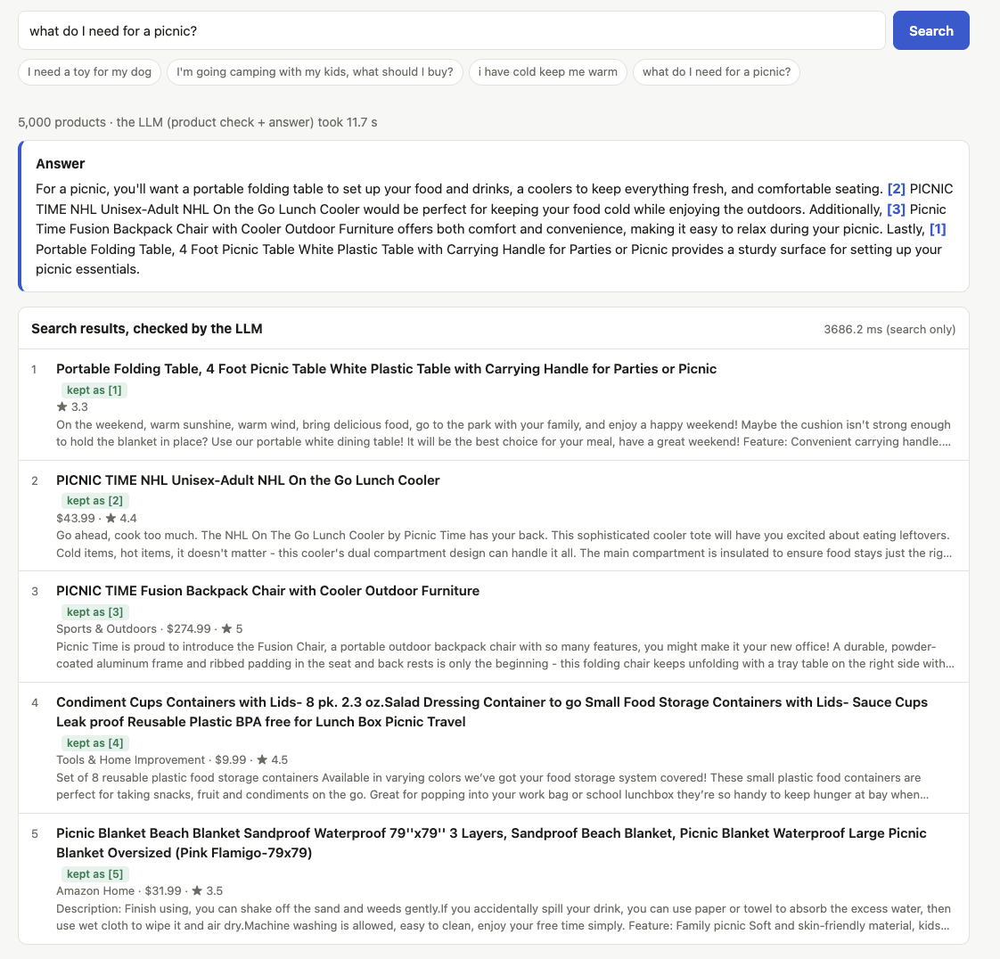
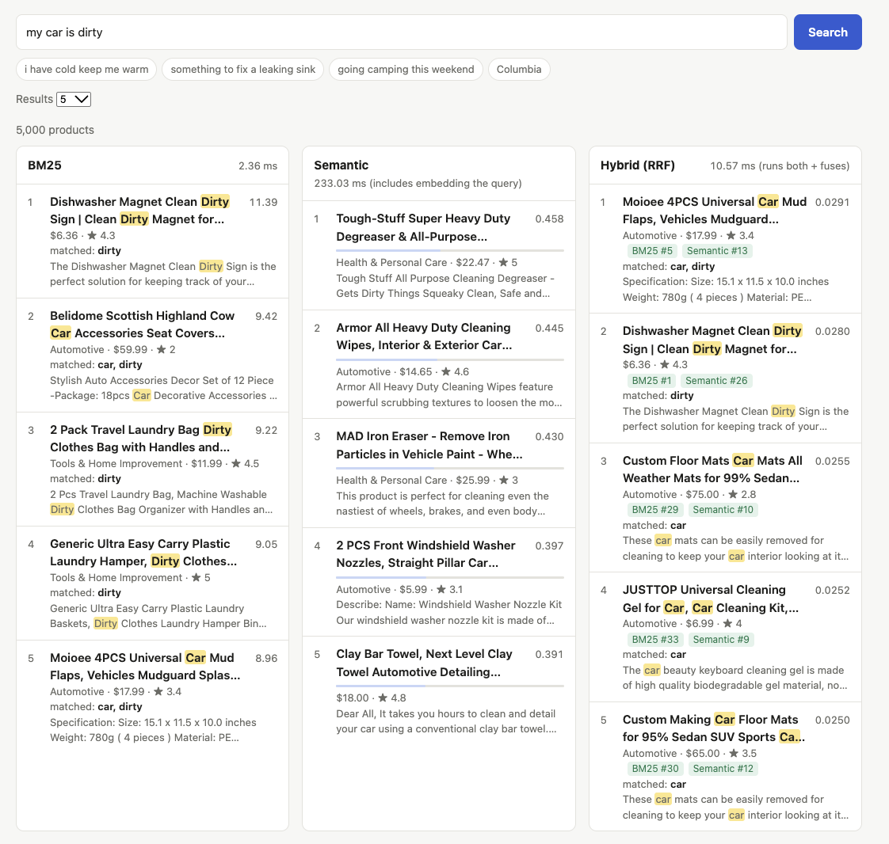

# Semantic Product Search and RAG

A product search engine built step by step, from keyword matching to embeddings, vector search,
hybrid search and an LLM that answers questions using the search results. Every version is
measured on a hand-labeled test set, and a web app shows all of them side by side.

Data: 5,000 real Amazon products. Everything runs locally on an 8 GB laptop
(bigger LLMs were tested on a free Colab GPU).



## Results

Search quality on 18 labeled test queries (nDCG@10, higher is better, all measured on the same 870 labels):

| Version | nDCG@10 |
|---|---|
| Keyword search (count matching words) | 0.35 |
| BM25 | 0.56 |
| Embeddings, all-MiniLM-L6-v2 | 0.65 |
| Embeddings, BGE-small | 0.67 |
| BGE-small fine-tuned on 15k synthetic queries | 0.65 |
| gte-small fine-tuned on 15k LLM-written queries | 0.69 |
| Embeddings, gte-small | 0.73 |

RAG answers on 20 test questions (share of recommended products that are relevant):

| LLM | Product check | Precision | Says "nothing fits" when the shop has nothing |
|---|---|---|---|
| Qwen2.5-1.5B (laptop) | none | 58% | 0 of 2 |
| Qwen2.5-3B (Colab) | LLM checks each product first | 91% | 2 of 2 |

## What I learned

- I labeled 870 query-product pairs by hand, and a second labeler (an AI model) labeled them too.
  We agreed on 91% of them (Cohen's kappa 0.79). Some changes that looked better at first did not
  hold up once I measured them.
- Fine-tuning did not help. I tried it 4 times, with 3 kinds of generated training queries and 2
  learning rates. The training loss always went down, but every trained model scored lower on my
  labeled queries than the model it started from. Generated queries about 5,000 products were too
  narrow, and the model forgot part of what it knew. Switching to another existing model helped more.
- A 3x bigger embedding model scored lower than gte-small.
- Without a check, the LLM recommended whatever the search found, for example a dog statue for
  "dog toy". A score threshold could not tell when to say "nothing fits", but asking the LLM yes or no
  for each product worked.
- New models looked worse at first, because the products only they found had never been labeled.
  After labeling those too, the comparison was fair.

## How it works

The project is split into levels. Each level adds one idea and keeps the code of the earlier ones
in `src/semantic_search/levels/levelN/`, so every version can still be run and compared.

| Level | Adds | Main result |
|---|---|---|
| 1 | Keyword search vs. embeddings (all-MiniLM-L6-v2) on 30 hand-written products | meaning beats exact words |
| 2 | 5,000 real Amazon products, cleaning and sampling | real data is messy |
| 3 | Embedding cache, FAISS index, HNSW approximate search | start-up 23 s -> 1 s, search up to 300x faster |
| 4 | BM25 and hybrid search (Reciprocal Rank Fusion) | fixes the worst keyword mistakes |
| 5 | Labeled test set, P@5 / R@10 / MRR / nDCG@10, experiments | numbers instead of opinions |
| 6 | Fine-tuning with synthetic queries, comparing more models | gte-small wins, fine-tuning doesn't |
| 7 | RAG with a local LLM and an LLM product check | grounded answers, 91% precision with 3B |
| 8 | Fine-tuning again, with training queries written by an LLM (on Colab) | still below no training |



Stack: Python, PyTorch, sentence-transformers, FAISS, Hugging Face transformers and datasets, FastAPI, uv, pytest.

## Project structure

```
├── data/
│   ├── products.json             # tiny hand-made catalog (30 products)
│   ├── amazon_products.json      # real Amazon sample (created by `prepare-data`, not in git)
│   └── eval/                     # test set: pool of query-product pairs, labels, RAG answers
├── notebooks/
│   ├── level7_colab.ipynb        # RAG evaluation with a bigger LLM on a free Colab GPU
│   └── level8_colab.ipynb        # LLM-written training queries and fine-tuning on a Colab GPU
├── src/semantic_search/
│   ├── web.py                    # web app (FastAPI), one tab per level
│   ├── static/                   # search page and labeling page
│   └── levels/                   # each level's full code
│       ├── level1/               # data, keyword_search, semantic, cli
│       ├── level2/               # + prepare_data (download Amazon data)
│       ├── level3/               # + cache, FAISS / HNSW, benchmark
│       ├── level4/               # + BM25 and hybrid search
│       ├── level5/               # + evaluation: labels, metrics, experiments
│       ├── level6/               # + fine-tuning: synthetic training queries, training
│       ├── level7/               # + RAG: an LLM answers with products from the search
│       └── level8/               # + fine-tuning with LLM-written training queries (latest)
└── tests/
```

## Quick start

Requires [uv](https://docs.astral.sh/uv/).

```bash
uv sync                                   # install dependencies
uv run prepare-data                       # download and clean the Amazon products (~1 min)
uv run web                                # web app with one tab per level: http://127.0.0.1:8000
uv run semantic-search --amazon           # search in the terminal (keyword, BM25, semantic, hybrid)
uv run ask --check "I need a toy for my dog"   # RAG answer in the terminal
uv run pytest                             # run the tests
```

The first run downloads the models (an embedding model of ~130 MB and, for RAG, an LLM of ~3 GB).

## Level 1: keyword vs. semantic search

```
products.json ──► embedding model ──► product vectors (computed once)
                                               │
user query ────► embedding model ──► query vector ──► cosine similarity ──► top-k products
```

| Keyword search | Semantic search |
|---|---|
| Matches the exact words in the query | Matches what the query means |
| "gift for a 6 year old" finds the JBL Flip 6 speaker (because of the "6") | finds LEGO bricks and a Harry Potter box set |

## Level 2: real Amazon data

```bash
uv run prepare-data                        # download, clean, keep 5,000 random products (~1 min)
uv run semantic-search --amazon            # search them
uv run prepare-data -n 20000 --files 2     # more products (slower to embed)
```

Data: [milistu/AMAZON-Products-2023](https://huggingface.co/datasets/milistu/AMAZON-Products-2023)
(117k products from the Amazon Reviews 2023 dataset). Only the needed Parquet columns are
downloaded; rows with empty or duplicate titles, very short descriptions, or digital-only
categories are dropped.

```
Search> keep me warm when it snows
  Keyword:
     4.000  Red White Blue Patriotic Dangle Earrings for Women Girls 4th of July ...
  Semantic:
     0.496  Tough Headwear Full Face Mask for Cold Weather for Men - Work Balaclava ...
     0.445  Columbia Men's Basin Trail Fleece Full Zip
```

## Level 3: cache, FAISS and HNSW

- The product vectors are saved to disk, named by a hash of the products and the model, so the app
  starts in about 1 second instead of 23.
- A FAISS index replaces the numpy search. `IndexFlatIP` is exact; `IndexHNSWFlat` searches a graph
  of neighbours and checks only a small part of the products.
- On 200,000 vectors HNSW was 34x to 299x faster than exact search, with 48% to 90% recall depending
  on `efSearch` (`uv run python -m semantic_search.levels.level3.benchmark`).

## Level 4: BM25 and hybrid search

- BM25 (`levels/level4/bm25.py`): keyword ranking where rare words count more (IDF),
  repeated words count less and less (k1), and long texts are normalized (b). An inverted
  index makes it about 1000x faster than the old keyword search (0.07 ms vs 75 ms).
- Hybrid (`levels/level4/hybrid.py`): combines BM25 and semantic rankings with
  Reciprocal Rank Fusion, `1/(60 + rank)` summed over both lists.

| Query | BM25 | Semantic | Hybrid |
|---|---|---|---|
| i have cold keep me warm | winter coat, mittens | face mask, fleece | mittens, face mask, coat |
| something to fix a leaking sink | an "I Fix Stuff" hat (wrong) | kitchen mat | sink caddy (BM25 #2, semantic #2) |
| going camping this weekend | a sweater dress (wrong, "weekend" is a rare word) | tent, sleeping bag | sleeping pad, sleeping bag (the tent drops out) |

Hybrid removes the worst mistakes of each method, but it is not better on every query.
Measuring that properly is the next step (evaluation).

## Level 5: evaluation

Measure every method on labeled queries instead of looking at a few examples.

1. Test queries (`levels/level5/queries.py`): 20 queries of 4 types: intent, simple, exact, tricky.
2. Pooling (`pool.py`): the top 10 of every method are merged into `data/eval/pool.json`
   (684 query-product pairs). Only these are labeled.
3. Labeling (`/label` page in the web app): each pair is marked relevant or not, without seeing
   which method found it. Two labelers (the author and an AI model) labeled everything separately
   and agreed on 91% of the pairs
   (Cohen's kappa 0.80).
4. Metrics (`evaluate.py`): P@5, R@10, MRR and nDCG@10.
5. Experiments: tuning hybrid (`tune.py`) and comparing embedding models (`compare_models.py`).

| Method | Model | nDCG@10 |
|---|---|---|
| Keyword | - | 0.360 |
| BM25 | - | 0.570 |
| Semantic | all-MiniLM-L6-v2 (Levels 1-4) | 0.664 |
| Semantic | all-mpnet-base-v2 (5x bigger) | 0.646 |
| Semantic | BAAI/bge-small-en-v1.5 | 0.684 |
| Hybrid | MiniLM, tuned (k=5, semantic weight 2) | 0.695 |
| Hybrid | BGE-small (k=60, equal weights) | 0.697 |

Level 5 uses BGE-small with plain hybrid by default. The bigger model was not better, and the
first model comparison looked wrong until the new models' results were labeled too (pool bias).
With 18 queries, the top results are too close to call a clear winner.

```bash
uv run python -m semantic_search.levels.level5.evaluate          # agreement + metrics
uv run python -m semantic_search.levels.level5.tune              # Experiment 1: hybrid settings
uv run python -m semantic_search.levels.level5.compare_models    # Experiment 2: embedding models
uv run python -m semantic_search.levels.level5.pool --add-models # add new models' results to the pool
```

## Level 6: fine-tuning

Train BGE-small on our products, then measure it on the Level 5 labels.

1. Training data without hand labels (`levels/level6/generate_queries.py`): a small T5 model
   (`doc2query/msmarco-t5-small-v1`) writes 3 queries per product: 14,850 (query, product) pairs.
2. Training (`train.py`): `MultipleNegativesRankingLoss`, batch 16, texts cut to 128 tokens,
   1 epoch, about 10 minutes on an 8 GB Mac. Batch 32 with 256 tokens ran out of memory.
3. Shopping-style data (`shopping_queries.py`): question words removed ("what is a hose nozzle" ->
   "hose nozzle") and short queries from titles ("water bottle"), shared by many products.

The 20 test queries are removed from all training data, also as plurals.

| Model | Training | nDCG@10 |
|---|---|---|
| BGE-small | none | 0.674 |
| BGE-small | T5 questions | 0.648 |
| BGE-small | shopping-style queries | 0.657 |
| bge-base-en-v1.5 (3x bigger) | none | 0.687 |
| thenlper/gte-small | none | 0.734 |

(Measured on 808 labeled pairs: every model's top results were labeled, so no model is judged unfairly.)

The loss on unseen products went down a lot (0.31 -> 0.10), but the search on our labeled queries
did not get better. The training task (find the one product a query was written from) was different
from ours (find every product of a kind). Shopping-style data fixed simple searches
(coffee mug 0.41 -> 0.86) but hurt others.

Then two other models were tested without training. gte-small, the same size and speed as BGE-small,
was better on 11 of the 18 queries and worse on 2, so Level 6 uses gte-small. Choosing a better
existing model helped more than training our own.

```bash
uv run python -m semantic_search.levels.level6.generate_queries            # ~5 min
uv run python -m semantic_search.levels.level6.shopping_queries
uv run python -m semantic_search.levels.level6.train --batch-size 16 --data t5        # ~10 min
uv run python -m semantic_search.levels.level6.train --batch-size 16 --data shopping  # ~10 min
uv run python -m semantic_search.levels.level6.compare_models   # all models on the labeled queries
```

Generated data (`data/train/`) and trained models (`models/`) are not in git.

## Level 7: RAG (Retrieval-Augmented Generation)

The search finds products, and an LLM writes an answer that uses only those products.

1. Search: gte-small finds the top 5 products for the question.
2. Check: the LLM answers yes/no for each product ("could it be useful for what the customer wants?").
3. Answer: the LLM gets the kept products, numbered [1]..[5], and writes a short answer that cites them.
   If the check removed everything, the answer is "the shop doesn't have anything that fits".

```bash
uv run ask "I'm going camping with my kids, what should I buy?"           # without the check
uv run ask --check "I need a toy for my dog"                              # with the product check
uv run python -m semantic_search.levels.level7.rag_eval --check          # all 20 labeled queries
```

The LLM is `Qwen/Qwen2.5-1.5B-Instruct` (about 3 GB, 15 to 30 seconds per answer on an 8 GB Mac).
`notebooks/level7_colab.ipynb` runs the same evaluation with `Qwen2.5-3B-Instruct` on a free Colab GPU.

| LLM | Product check | Precision | Refused when nothing fits | Refused although good products were found |
|---|---|---|---|---|
| Qwen 1.5B | none | 58% | 0 of 2 | 0 |
| Qwen 1.5B | yes | 65% | 1 of 2 | 0 |
| Qwen 3B | none | 66% | 0 of 2 | 0 |
| Qwen 3B | strict question | 94% | 2 of 2 | 7 |
| Qwen 3B | "could it be useful" | 91% | 2 of 2 | 3 |

Precision = recommended products that are relevant (Level 5 labels). No version invented a product.
Without the check, the LLM recommends whatever the search finds, even a dog statue for "dog toy".
Score thresholds could not decide when to refuse (for gte-small and for a cross-encoder reranker), but
an LLM check works if the model is big enough and the question is right.

The LLM can't be loaded in the web server (FAISS is loaded there first, and the LLM must come before
FAISS), so the web app runs RAG in its own process (`levels/level7/rag_service.py`).

## Level 8: fine-tuning with LLM-written training queries

Level 6 showed that the T5 training queries ("what is a hose nozzle") did not look like real searches.
Here a bigger LLM writes them, and the best model, gte-small, is trained on them.

1. Training data (`levels/level8/generate_llm_queries.py`, on a Colab GPU): `Qwen2.5-3B-Instruct` writes
   3 searches per product: the kind of product, a need it solves, and a feature. 14,911 queries, for
   example "baby bedding for boys" or "gift idea for dad on his birthday". The test queries are removed.
2. Training (`train.py --data llm`): gte-small, batch 64, texts of 256 tokens, learning rate 2e-5 or 5e-6.
3. The first run broke: gte-small is stored in float16, training in float16 overflowed, and every weight
   became NaN. Training now loads the model in float32 and refuses to save a model with NaN weights.
   The embedding cache also checks when the weights were saved, so a retrained model is not mixed up
   with an older one that has the same folder name.

| Model | Training data | Learning rate | nDCG@10 | Same model without training |
|---|---|---|---|---|
| BGE-small | T5 questions | 2e-5 | 0.648 | 0.674 |
| BGE-small | shopping-style queries | 2e-5 | 0.657 | 0.674 |
| gte-small | LLM-written queries | 2e-5 | 0.688 | 0.734 |
| gte-small | LLM-written queries | 5e-6 | 0.680 | 0.734 |

(Measured on 870 labeled pairs.) The LLM-written queries were better than the T5 ones, and some needs
got better (my kitchen is too messy 0.39 -> 0.51), but exact searches got worse (phone charger
0.62 -> 0.32, LED light 0.86 -> 0.53). Queries like "gift idea for ..." taught the model that anything
giftable fits "gift". No fine-tuning beat the model it started from, so gte-small without training
stays the default. Fine-tuning usually needs real user searches and clicks.

```bash
# on Colab: notebooks/level8_colab.ipynb (writes the queries and trains)
uv run python -m semantic_search.levels.level8.compare_models --models gte-small,gte-small-llm,gte-small-llm-lr5e-06
```

## Web app

```bash
uv run web          # then open http://127.0.0.1:8000
```

One tab per level: Level 1 (30 products), Level 2 (Amazon data), Level 3 (Flat vs HNSW with
search times and an efSearch slider), Level 4 (BM25 vs semantic vs hybrid), Level 5 (results table, and
BM25 vs semantic vs hybrid with BGE-small), Level 6 (BGE-small before and after fine-tuning, and gte-small),
Level 7 (ask a question, get an LLM answer with the products it used),
Level 8 (gte-small without training and its two fine-tuned versions). Each tab runs that level's own code from
`src/semantic_search/levels/`, copied from the git tags. The `semantic-search`, `prepare-data` and
`benchmark` commands run the latest level. Only the import paths and the data
folder depth were changed, and `tests/test_levels.py` checks that against git.
The first search on the Level 2 tab takes about 25 seconds, because Level 2 had no embedding cache.

You can also run an old level's command-line app:

```bash
uv run python -m semantic_search.levels.level1.cli
uv run python -m semantic_search.levels.level2.cli --amazon
```

A link like `http://127.0.0.1:8000/?q=running+shoes#level2` opens a search directly.

## Next steps

- Add more test queries, so close methods can be told apart.
- Fine-tune with real data: searches and clicks from users, instead of generated queries.
- Run RAG with a bigger LLM in the web app (for example through an API), since 3B does not fit in 8 GB.
